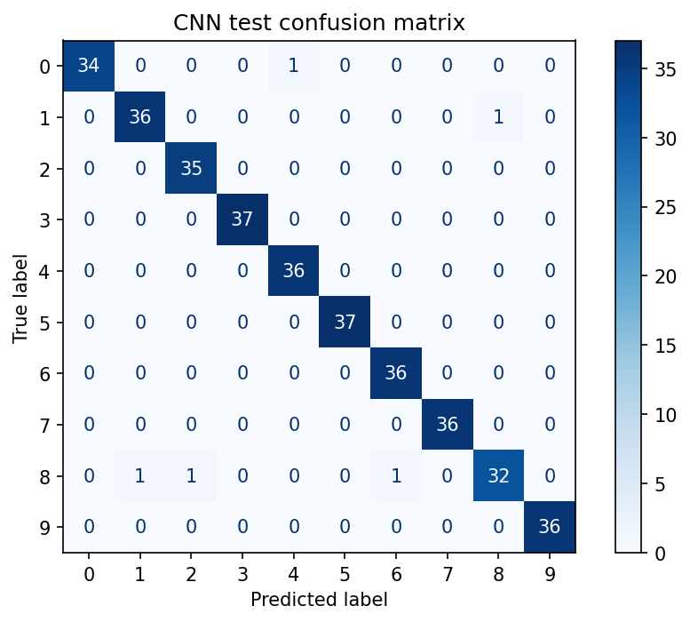
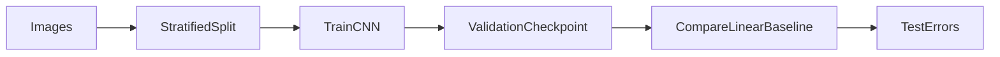
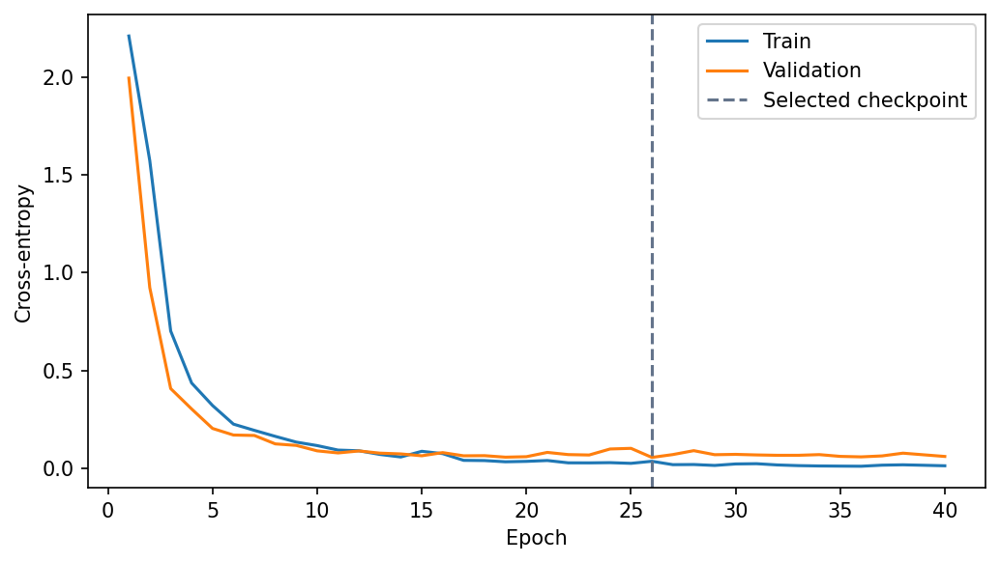
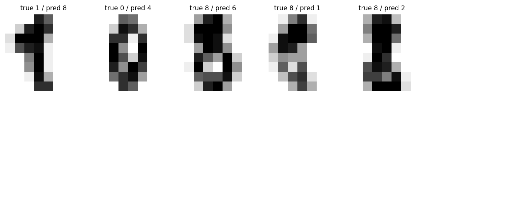

<p align="center"></p>

# Digits CNN Lab

**A compact vision model you can train and inspect on a CPU.**

[](https://github.com/Djordje3002/digits-cnn-lab/actions/workflows/ci.yml)


Recognize handwritten digits from 8×8 grayscale images while demonstrating the complete deep-learning experiment cycle: deterministic initialization, minibatch optimization, validation checkpointing, a classical baseline and visual error analysis.

**Project 5/6 · Advanced** in the [Machine Learning Portfolio](https://github.com/Djordje3002/ml-portfolio).

## What this project demonstrates

PyTorch · convolutional networks · checkpointing · cross-entropy · error analysis.

Working training and prediction commands, real benchmark data, baseline comparisons, committed measured reports, an experiment-review notebook, regression tests and CI. This is a reproducible portfolio experiment; results describe the stated benchmark protocol.

## Measured results

| Model | accuracy | macro f1 | log loss |
| --- | ---: | ---: | ---: |
| `scaled_logistic` | 0.9639 | 0.9640 | 0.1263 |
| `cnn` | 0.9861 | 0.9858 | 0.0598 |


**Selected using training CV or validation:** `cnn`. The tables report test results; selection is never changed to favor the test winner.

The restored CNN reaches 98.61% test accuracy versus 96.39% for logistic regression on this split. Five of 360 test images are wrong. Inspect the error gallery and learning curve before interpreting a headline accuracy. Softmax confidence is not calibrated, and a random image split does not measure performance on entirely unseen writers.



Full precision, split counts, package versions and source provenance are in [metrics.json](reports/metrics.json). The committed run used Python 3.11 on macOS with seed 42. Results can vary slightly across platforms and dependency versions. These numbers are benchmark measurements, not production performance promises.

## Run locally

Use Python 3.11 or 3.12 and run commands from the repository root. No API key, paid service or GPU is required. The first training run downloads the small source archive; subsequent runs verify and reuse the local cache. The digits project uses scikit-learn's bundled dataset instead.

```bash
git clone https://github.com/Djordje3002/digits-cnn-lab.git
cd digits-cnn-lab
python3.11 -m venv .venv
source .venv/bin/activate
python -m pip install -e ".[dev]"
python -m digits_cnn train
python -m digits_cnn predict --input examples/sample.json
python -m pytest -q
```

On Windows, activate with `.venv\Scripts\activate`. A Python 3.12 installation can replace `python3.11` in the setup command. Start with a few minutes of CPU time; training time depends on your machine, with the CNN and factorization requiring more work than the small tabular examples.

Training writes local models to `artifacts/` and refreshes `reports/`. Datasets and trained binaries are excluded from Git. The example JSON is an input contract, and predictions are calculated from the locally trained model.

## Experiment design



The scikit-learn digits subset contains 1,797 real images. A seeded stratified 60%/20%/20% image split gives 1,078 training, 359 validation and 360 test examples. Values are normalized by the fixed known sensor maximum, 16. The CNN uses two convolutions, max pooling, a hidden layer and dropout, totaling 38,282 parameters. AdamW trains for 40 epochs on CPU; the checkpoint with lowest validation cross-entropy is restored. A scaled logistic baseline uses the same training examples. Validation log loss selects the stronger family; test results are reported for both. The prediction CLI explicitly demonstrates the CNN checkpoint.

### Data provenance

The 1,797-image digits dataset bundled with scikit-learn is a copy of the original UCI optical-digits test subset. Each 8×8 image has integer intensities 0–16 and a label 0–9. This project re-splits that subset for a compact educational experiment; it does not reproduce the original UCI train/test protocol or use MNIST.

Source: [Digits CNN Lab dataset](https://archive.ics.uci.edu/dataset/80/optical+recognition+of+handwritten+digits). See [Data card](docs/DATA_CARD.md) for attribution, integrity and usage terms.

## Explore the evidence

- [Experiment review notebook](notebooks/01_review_results.ipynb): inspect the committed metrics, compare models and view the actual evaluation chart.
- [Model card](docs/MODEL_CARD.md): intended use, evaluation boundary and failure modes.
- [Experiment protocol](docs/EXPERIMENTS.md): reproduction steps and selection rules.
- [Prediction input](examples/sample.json): a complete example for the command-line interface.





The error images derive from the cited UCI dataset under CC BY 4.0. The 8×8 zero in `examples/sample.json` was manually drawn for this project.

## Repository structure

```text
src/digits_cnn/       Training, prediction and integrity helpers
tests/                   Offline regression and contract tests
data/source.json         Source URL and expected SHA-256 (downloaded datasets)
data/raw/                Local verified dataset cache; ignored by Git
examples/                Ready-to-run prediction inputs
notebooks/               Executed experiment review
reports/                 Measured metrics and evaluation plots
docs/                    Data card, model card and experiment protocol
artifacts/               Locally trained models; ignored by Git
.github/workflows/       Lint, tests and full benchmark training
```

## Quality checks

```bash
make check test
make train
```

Forward logits and backward gradients remain finite; train/validation/test indices are disjoint; a weights-only CPU checkpoint loads correctly; probabilities sum to one; wrong-size, out-of-range and non-finite images are rejected.

CI repeats lint, formatting, tests and the complete training/evaluation command on Linux, then uploads reports for inspection. Training requires network access only on a cache miss. Offline tests use small constructed fixtures rather than substitute benchmark data.

## Limits and responsible interpretation

Writer IDs are unavailable in the bundled subset, so writers can appear across partitions. The small images and curated preprocessing differ greatly from camera photos and scanned documents. There is no image upload or OCR pipeline. CPU determinism is requested, but different libraries, hardware or platforms can still produce small numeric differences. An all-zero input is schema-valid and can still get a confident prediction; out-of-distribution rejection is not implemented.

## License and attribution

Code is [MIT licensed](LICENSE). Dataset rights are separate; see [Data card](docs/DATA_CARD.md). Built with Python and the libraries listed in [pyproject.toml](pyproject.toml).

**Dataset citation:** Alpaydin, E. & Kaynak, C. (1998). Optical Recognition of Handwritten Digits. UCI Machine Learning Repository. https://doi.org/10.24432/C50P49 . Subset distributed by scikit-learn: https://scikit-learn.org/stable/modules/generated/sklearn.datasets.load_digits.html

Created by [Djordje Kartaljevic](https://github.com/Djordje3002). [Explore the full progression →](https://github.com/Djordje3002/ml-portfolio)
